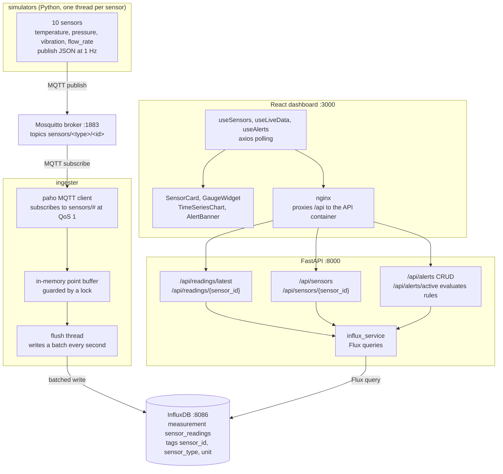

# IoT Pulse - Real-Time Sensor Data Pipeline & Dashboard

An MQTT-based IoT sensor data pipeline with a real-time monitoring dashboard. Sensor simulators generate data, which flows through an MQTT broker into InfluxDB, is served via a FastAPI REST API, and visualized in a React/TypeScript dashboard.

## Architecture



Alert rules live in an in-memory dict inside the API process, so they are
evaluated on demand by `/api/alerts/active` against the latest readings rather
than by a background evaluator, and they reset when the container restarts.


**Data flow:** Simulators publish JSON readings to MQTT topics (`sensors/<type>/<id>`) at 1Hz. The ingester subscribes to `sensors/#`, batches points, and writes to InfluxDB. The FastAPI API queries InfluxDB and serves endpoints for the React dashboard. The frontend proxies API requests through nginx.

## Prerequisites

- [Docker](https://docs.docker.com/get-docker/) (v20+)
- [Docker Compose](https://docs.docker.com/compose/install/) (v2+)

No other dependencies are required -- everything runs in containers.

## Quick Start

1. Copy the environment file:

   ```bash
   cp .env.example .env
   ```

2. Build and start all services:

   ```bash
   docker-compose up --build
   ```

3. Open the dashboard: [http://localhost:3000](http://localhost:3000)

That's it. The simulators will immediately start generating data, and readings will appear in the dashboard within a few seconds.

## Accessing the Services

| Service     | URL                          | Description                    |
|-------------|------------------------------|--------------------------------|
| Dashboard   | http://localhost:3000         | React monitoring UI            |
| API         | http://localhost:8000         | FastAPI REST API               |
| API Docs    | http://localhost:8000/docs    | Swagger/OpenAPI documentation  |
| InfluxDB UI | http://localhost:8086         | InfluxDB admin (admin/adminpassword) |
| MQTT Broker | localhost:1883               | Mosquitto MQTT broker          |

## API Documentation

### Health Check

```bash
curl http://localhost:8000/health
```

### List All Sensors

```bash
curl http://localhost:8000/api/sensors
```

### Get Sensor Details

```bash
curl http://localhost:8000/api/sensors/temp-01
```

### Get Latest Readings (All Sensors)

```bash
curl http://localhost:8000/api/readings/latest
```

### Get Time-Series Data

```bash
# Last hour, 30s aggregation windows
curl "http://localhost:8000/api/readings/temp-01?start=-1h&end=now()&window=30s"

# Last 5 minutes, 5s windows
curl "http://localhost:8000/api/readings/temp-01?start=-5m&window=5s"
```

### Create an Alert Rule

```bash
curl -X POST http://localhost:8000/api/alerts \
  -H "Content-Type: application/json" \
  -d '{"name": "High temp", "sensor_id": "temp-01", "condition": "above", "threshold": 28, "severity": "warning"}'
```

### List Alert Rules

```bash
curl http://localhost:8000/api/alerts
```

### Check Active Alerts

```bash
curl http://localhost:8000/api/alerts/active
```

### Delete an Alert Rule

```bash
curl -X DELETE http://localhost:8000/api/alerts/<alert_id>
```

## Configuration Reference

All configuration is done through environment variables (see `.env.example`):

| Variable | Default | Description |
|----------|---------|-------------|
| `MQTT_BROKER` | `mosquitto` | MQTT broker hostname |
| `MQTT_PORT` | `1883` | MQTT broker port |
| `INFLUX_URL` | `http://influxdb:8086` | InfluxDB URL |
| `INFLUX_TOKEN` | `iot-pulse-dev-token` | InfluxDB API token |
| `INFLUX_ORG` | `iot-pulse` | InfluxDB organization |
| `INFLUX_BUCKET` | `sensor_data` | InfluxDB bucket name |
| `DOCKER_INFLUXDB_INIT_USERNAME` | `admin` | InfluxDB admin username |
| `DOCKER_INFLUXDB_INIT_PASSWORD` | `adminpassword` | InfluxDB admin password |
| `VITE_API_BASE_URL` | (empty) | Frontend API base URL override |

## Simulated Sensors

| Type | Count | Base Value | Range | Topic Pattern |
|------|-------|------------|-------|---------------|
| Temperature | 4 | 25 C | +/- 2 C | `sensors/temperature/temp-{01..04}` |
| Pressure | 2 | 110 PSI | +/- 10 PSI | `sensors/pressure/press-{01..02}` |
| Vibration | 2 | 3 mm/s | +/- 2 mm/s | `sensors/vibration/vib-{01..02}` |
| Flow Rate | 2 | 120 L/min | +/- 30 L/min | `sensors/flow_rate/flow-{01..02}` |

All sensors publish at 1Hz with Gaussian noise and a 2% chance of anomaly spikes.

## Individual Service Development

### Simulators (Python)

```bash
cd simulators
pip install paho-mqtt
MQTT_BROKER=localhost python -m simulators.run_simulators
```

### Ingester (Python)

```bash
cd ingester
pip install -r requirements.txt
MQTT_BROKER=localhost INFLUX_URL=http://localhost:8086 python -m ingester.mqtt_consumer
```

### API (Python/FastAPI)

```bash
cd api
pip install -r requirements.txt
INFLUX_URL=http://localhost:8086 uvicorn api.main:app --reload --port 8000
```

### Frontend (React/Vite)

```bash
cd frontend
npm install
VITE_API_BASE_URL=http://localhost:8000 npm run dev
```

## Test

There is no automated test suite checked in. End-to-end verification:

```bash
# 1. Bring the stack up
docker-compose up --build -d

# 2. Confirm API health
curl -fsS http://localhost:8000/health

# 3. Confirm sensors are publishing and being ingested
curl -s http://localhost:8000/api/sensors | jq 'length'        # expect 10
curl -s http://localhost:8000/api/readings/latest | jq 'length' # expect 10

# 4. Confirm time-series ingestion is live (run twice ~10s apart)
curl -s "http://localhost:8000/api/readings/temp-01?start=-1m&window=5s"

# 5. Confirm alert evaluation
curl -s -X POST http://localhost:8000/api/alerts \
  -H "Content-Type: application/json" \
  -d '{"name":"smoke","sensor_id":"temp-01","condition":"above","threshold":-100,"severity":"info"}'
sleep 5
curl -s http://localhost:8000/api/alerts/active | jq .

# 6. Confirm MQTT directly
docker exec -it $(docker ps -qf name=mosquitto) \
  mosquitto_sub -h localhost -t 'sensors/#' -C 5
```

## Stopping

```bash
docker-compose down -v
```

The `-v` flag removes the named volumes (InfluxDB data, Mosquitto data), giving you a clean slate on next start.
